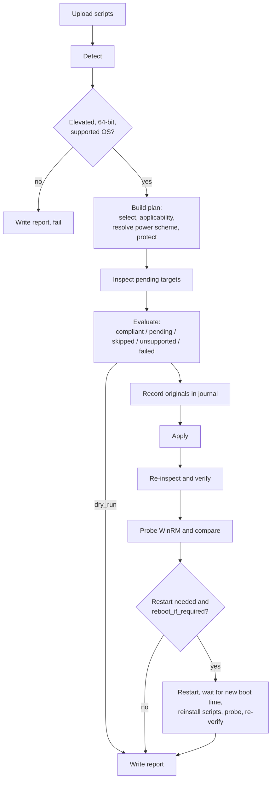

# 🏗️ Architecture

## Principles

- **Go decides, the guest only reads and writes.** Selection, applicability, protection, comparison, verification and the journal format are decided in Go. The PowerShell scripts detect facts, read a target, and set a target. This keeps every decision unit-testable without Windows.
- **Declarative catalog.** An optimization is data: an ID, documentation, OS rules, and a list of changes. A change is one target set to one value. There are six reversible target kinds, so detect, apply, verify and rollback are implemented once per kind, not once per optimization.
- **All or nothing per optimization.** If any change of an optimization is protected, can't be inspected, or can't be restored, none of its changes is applied.
- **Nothing is reported as done without reading it back.**
- **The journal is written before anything is changed.**

## Packages

| Path | Role |
| --- | --- |
| `main.go` | Plugin entry point; registers the `windows-optimize` provisioner. |
| `provisioner/` | HCL config and validation, run orchestration, guest access, restart. |
| `internal/catalog/` | The optimization model, the embedded catalog, catalog validation. |
| `internal/plan/` | Selection, applicability, power scheme resolution, protection rules, compare and verify, rollback journal. Pure: no I/O. |
| `internal/facts/` | Decoding guest facts, OS classification, WinRM regression checks. |
| `internal/report/` | JSON report and console summary. |
| `guest/scripts/` | Embedded PowerShell 5.1 scripts run on the guest. |
| `cmd/catalogdoc/` | Generates [catalog.md](catalog.md) from the catalog. |
| `cmd/doccheck/` | Enforces the Go documentation rules. |

## Run flow

Each guest action is one `powershell.exe -NoProfile -NonInteractive -ExecutionPolicy Bypass -File Invoke-WindowsOptimize.ps1 -Action <name>` call in a working directory `C:\Windows\Temp\packer-windows-optimize-<uuid>`. Input and output are JSON files that the plugin uploads and downloads, so no data passes through the command line or console encoding. The working directory is removed at the end.

| Action | Input | Output |
| --- | --- | --- |
| `Detect` | — | OS, session, WinRM (service, dependencies, listeners, auth), power schemes, detection errors |
| `Probe` | — | WinRM, session, last boot time |
| `Inspect` | `[{id, target}]` | `{items: [{id, present, type, data, error}]}` |
| `Apply` | `[{id, target, want}]` | `{items: [{id, ok, error}]}` |
| `ReadJournal` | — | `{path, content}` |
| `WriteJournal` | `{source}` | `{path}` |

A failure of one target is reported in its item and never stops the others. A non-zero exit code means the action itself failed.

## Target kinds

| Kind | Read | Write | Rollback restores |
| --- | --- | --- | --- |
| `registry` | 64-bit HKLM view through `RegistryKey`, never WOW64-redirected | `REG_DWORD` or `REG_SZ`, creating the key | the old value, or deletes it if it was absent |
| `service` | `Start` and `DelayedAutostart` in the registry | `sc.exe config <name> start= …` (services are never started or stopped) | the old start type |
| `scheduled_task` | `Get-ScheduledTask` by folder and name | `Enable-` / `Disable-ScheduledTask` | enabled or disabled |
| `power_setting` | `PowerReadACValueIndex` / `PowerReadDCValueIndex` | `PowerWrite…ValueIndex`, then the active scheme is activated again so it takes effect | the old index in the same scheme |
| `power_scheme` | `PowerGetActiveScheme` | `PowerSetActiveScheme` | the old active scheme |
| `hibernation` | `HibernateEnabled` (or `HibernateEnabledDefault`) | `powercfg.exe /hibernate on\|off` | enabled or disabled |

Power settings use the documented `powrprof.dll` API instead of parsing `powercfg.exe` output, which is localized.

A value the plugin can't write back (a registry value of another type, a boot or system start service) is never changed. The optimization is skipped with that reason.

## Rollback journal

`%ProgramData%\packer-plugin-windows-optimize\journal.json` holds one entry per target the plugin has changed: the target, the original value, the optimization, whether it needs a restart, and when it was recorded.

- Entries are added **before** the apply step. If the build dies halfway, the journal already covers everything that may have changed.
- A target that is already in the journal keeps its entry. The journal always holds the value from before the **first** run that changed it, so running several builds or profiles in a row still rolls back to the original state.
- `rollback = true` inspects each entry, restores the ones that differ, verifies them, and writes back only the entries that failed. A fully restored journal is deleted.
- The directory is created with an ACL that allows only SYSTEM and Administrators, so a standard user can't plant entries that a later rollback would apply.
- Rollback only restores targets that a catalog optimization changes. Any other entry fails without being touched and stays in the journal, so even an edited journal can't make rollback change WinRM or a security control.
- Sysprep doesn't remove the journal. Images deployed from the template can be rolled back to the pre-optimization state with the same plugin.

## Idempotency

A second run with the same configuration inspects every target, finds it compliant, writes nothing, and doesn't ask for a restart. The plan and fake-guest tests check this for the `vdi` profile, which contains the other profiles.

## Design decisions

| Decision | Reason |
| --- | --- |
| Small catalog of validated optimizations | Each entry is documented by Microsoft, reversible and verifiable. A long list of undocumented registry values costs more in support than it gains. |
| No app removal, no component removal | Not reversible from a journal, and Microsoft doesn't support removing inbox components from a serviced image. |
| No changes to user profiles or the default user hive | They can't be verified per user, and `HKU\.DEFAULT` isn't the default profile new users get. |
| Policy registry values instead of preference values | Policies are documented in the Policy CSP or ADMX reference and are what Windows honors. |
| High-risk only by exact ID | A wildcard written for one purpose must never pull in a change that can lose data or block updates. |
| Restart only on request | Packer's workflow owns restarts. The plugin never restarts unexpectedly, and the report says when a restart is still required. |
